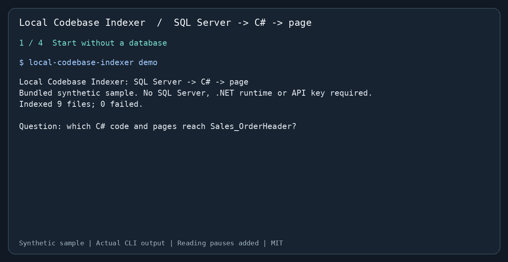

# Local Codebase Indexer

**English** | [繁體中文](https://github.com/sfy257000/local-codebase-indexer/blob/main/README.zh-TW.md) | [简体中文](https://github.com/sfy257000/local-codebase-indexer/blob/main/README.zh-CN.md)

**Which C# code and pages reach this SQL Server table?**

Trace tables and stored procedures to repositories, controller actions, and Razor pages in a local source tree. Use the CLI yourself or give your AI assistant the same evidence through MCP. Especially useful when maintaining C# / SQL Server applications with Dapper, ADO.NET, or Entity Framework.



[Case study and raw results](https://github.com/sfy257000/local-codebase-indexer/blob/main/docs/case-study.md) · [CLI reference](https://github.com/sfy257000/local-codebase-indexer/blob/main/docs/reference.md) · [PyPI](https://pypi.org/project/local-codebase-indexer/) · [MIT license](https://github.com/sfy257000/local-codebase-indexer/blob/main/LICENSE)

## Try it in three steps

Python **3.10+**. Run these in a virtual environment; no SQL Server, .NET runtime, model download, or API key is needed for the demo.

**1. Install**

```bash
python -m pip install --upgrade local-codebase-indexer
```

If Python reports an externally managed environment, create and activate a [virtual environment](https://docs.python.org/3/library/venv.html) first. See the [reference](https://github.com/sfy257000/local-codebase-indexer/blob/main/docs/reference.md#install) for isolated installation alternatives.

**2. Run the bundled example**

```bash
local-codebase-indexer demo
```

This creates a temporary **synthetic** source tree, indexes it, and checks four expected relationships. It does not index your current directory. The animation uses this command's actual output, with reading pauses added. An excerpt:

```text
table Sales_OrderHeader
  WRITTEN BY (2)
    [confirmed] procedure dbo.usp_ApproveOrder
    [confirmed] method Shop.Data.OrderRepository.Approve ... via usp_ApproveOrder
  READ BY (1)
    [confirmed] method Shop.Data.OrderRepository.Get
  USED BY PROGRAMS (1)
    [probable] Orders ... (Approve, Details)
        pages: Views/Orders/Details.cshtml
Verified 4/4 expected relationships: PASS
```

Use `local-codebase-indexer demo --output demo-orders` to keep a copy in a new or empty folder, or `demo --json` for the complete report.

**3. Point it at your source tree**

```bash
local-codebase-indexer --root "/path/to/project" data-access YourTable
```

Replace the path and table name. The first query builds the index; subsequent queries refresh it incrementally. SQL definitions must be present in source files for procedure bodies to be analyzed. There is no connection to a live database.

## Give the same evidence to your assistant

For Claude Code, after installing the package:

```bash
claude mcp add local-indexer -- local-codebase-indexer --root "/absolute/path/to/project" serve
```

Ask: “Which code writes `YourTable`, and which controller actions and pages reach it? Show paths and confidence levels.” Restart/reconnect the MCP client if needed. For other stdio MCP clients, use command `local-codebase-indexer` and arguments `--root`, your absolute project path, `serve`.

Codex / Copilot can use the CLI. [AGENTS.md](https://github.com/sfy257000/local-codebase-indexer/blob/main/AGENTS.md) contains assistant instructions. The [reference](https://github.com/sfy257000/local-codebase-indexer/blob/main/docs/reference.md) also covers the Claude Code plugin, seven MCP tools, ONNX models, aliases, and configuration.

## More maintenance questions

```bash
local-codebase-indexer --root "/path/to/project" relations OrderRepository.Approve --direction upstream
local-codebase-indexer --root "/path/to/project" impact main...HEAD
local-codebase-indexer --root "/path/to/project" search "order approval" --explain --limit 5
local-codebase-indexer --root "/path/to/project" doctor
```

Relations show callers; impact compares Git snapshots; search combines identifiers, text, and local embeddings. C#, Python, JavaScript, and TypeScript have symbol parsing; T-SQL and C# have additional data-access analysis. Add `--json` for structured output.

## What to verify

- This is **static analysis**, with confidence labels. Interface dispatch can be `probable`; name-only candidates and dynamic SQL require source verification. There is no Roslyn overload resolution or runtime execution proof.
- The default hashing embedder is best at identifiers and related terms. Natural-language paraphrases can miss results. [Benchmarks](https://github.com/sfy257000/local-codebase-indexer/blob/main/benchmarks/README.md) and the [case study](https://github.com/sfy257000/local-codebase-indexer/blob/main/docs/case-study.md) explain what was measured; four demo checks do not establish general accuracy or time savings.
- The index is local at `<project>/.ai_context/indexer.db`. Indexing needs no remote service after dependencies are installed. Your MCP client's model provider controls where returned context is sent.
- Start with a table or procedure that you know. If files are missing, run `doctor --path path/to/file.cs`; check `.gitignore` and `.ai_context/ignore`. See [known limitations](https://github.com/sfy257000/local-codebase-indexer/blob/main/docs/reference.md#differences-from-the-spec) and [planned work](https://github.com/sfy257000/local-codebase-indexer/blob/main/TODO.md).

Found a wrong edge or missing result? Open a [reproducible issue](https://github.com/sfy257000/local-codebase-indexer/issues/new/choose). [Contributions](https://github.com/sfy257000/local-codebase-indexer/blob/main/CONTRIBUTING.md) are welcome. Licensed under [MIT](https://github.com/sfy257000/local-codebase-indexer/blob/main/LICENSE).

<!-- mcp-name: io.github.sfy257000/local-codebase-indexer -->
