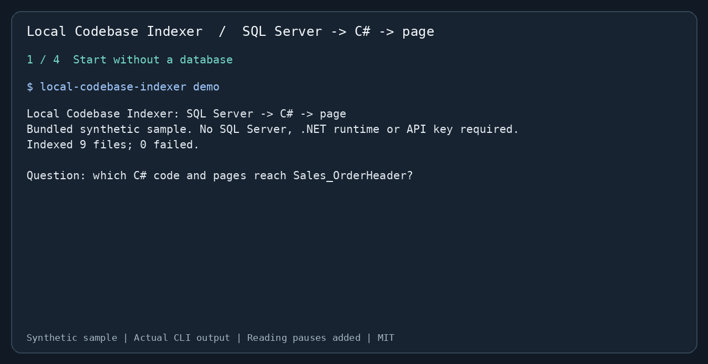

# Local Codebase Indexer

[English](README.md) | [繁體中文](README.zh-TW.md) | **简体中文**

**这张 SQL Server 数据表，会被哪些 C# 代码和页面使用？**

从源代码追踪数据表、存储过程、Repository、Controller Action 和 Razor 页面的关系。可以直接使用 CLI，也可以通过 MCP 让 AI 助手取得同样的路径与证据。适合维护使用 Dapper、ADO.NET 或 Entity Framework 的 C#／SQL Server 项目。



[可复现案例及完整输出](docs/case-study.md) · [进阶手册](docs/reference.zh-CN.md) · [PyPI](https://pypi.org/project/local-codebase-indexer/) · [MIT 许可](LICENSE)

## 与 Claude 的 Grep 及类似工具比较

**在本项目的 MES 测试集，相关文件召回率比 `rg + BM25` 高 9.5～10.7 个百分点。** 内置 SQL → C# → 页面调查场景中，关系报告覆盖 **5/5 个必要证据文件**，单次表名字面搜索为 **3/5**，覆盖率 **60% → 100%（+40 个百分点）**。

| 固定搜索测试集 | `rg + BM25` 文件 Recall@5 | 本项目 | 差异 |
|---|---:|---:|---:|
| MES 风格合成数据：42 题、24 个文件 | 81.0% | **91.7%** | **+10.7 个百分点** |
| 相同 42 题加入干扰来源：109 个文件 | 81.0% | **90.5%** | **+9.5 个百分点** |
| Python 标准库：12 题、85 个真实源代码文件 | **100.0%** | 79.2% | −20.8 个百分点 |

召回率是每题找回的已知相关文件比例，再取平均。基准实际运行 ripgrep，以通用查询拆词及 BM25 排序，并非 Claude agent。本项目使用默认 hashing、取 5 个结果块；基准取 5 个文件，双方都按文件评分。共 54 个由本项目编写的不同题目（含重跑干扰集共 96 次），不代表通用准确率保证。

**减少需要阅读的源代码：** 在含干扰的 MES 与标准库测试集，搜索结果文本比“完整读取同一批选中文件”少 **94.9%／96.9% 字符**；极小的合成文件反而多 **2.3%**。这是相对于整文件读取的输出大小，并非相对 Grep 片段或 Claude token 的节省量。

**较完整报告的成本：** demo CLI 暖查询 **244.5 ms**，单次字面 `rg` 为 **8.3 ms**（各测量 3 次取中位数；本项目首次查询含建索引为 **266.1 ms**）。提升在于多追到 Controller／页面；速度较慢。Controller 路径标为 `probable`，不代表运行时证明。尚未测量完整 Claude、Serena 或 Claude Context 流程。[方法与重跑命令](docs/tool-comparison.md) · [机器环境与汇总数据](benchmarks/tool-comparison.json) · [全部 96 条逐题记录](benchmarks/tool-comparison-queries.jsonl)。

**这个项目多提供的是 SQL → C# → 页面的索引关系报告。** 在支持的代码模式中，一次 `data-access` 查询就能列出直接／通过存储过程的访问、Controller Action、页面与置信度标签。Claude 也能通过多轮 Grep 和读文件追踪关系；该工具将这段调查整理成可重复执行的 CLI／MCP 结果。

| 工具／流程 | 适合用途 | 取舍与本项目的用途 |
|---|---|---|
| Claude＋Grep／ripgrep | 精确标识符、字符串和正则表达式，无需建立索引 | 直接核对文本仍优先使用。该项目另提供字面表名以外的 SQL／调用／页面关系。 |
| [Serena](https://github.com/oraios/serena)＋LSP／JetBrains | 后端提供的符号、引用和编辑／重构 | 精确 rename、重载解析优先使用编译器／IDE 语义。本项目聚焦 SQL 维护报告，无需配置语言服务器。 |
| [Claude Context](https://github.com/zilliztech/claude-context) | 自然语言的 BM25＋dense vector 混合搜索 | 官方配置包含 embedding provider 和 Milvus／Zilliz，也支持本地 provider。本项目默认无需 embedding API 或向量服务器，但 hashing 仍可能遗漏自然语言改写。 |
| Local Codebase Indexer | SQL Server 表／存储过程 → C# 访问者 → Action／页面，以及 schema、Git impact | 带有置信度标签的近似静态分析，没有 Roslyn 重载解析或语义 rename。 |

示例的 Controller 和 Razor 页面不含该表名字符串；关系报告通过存储过程和 C# 调用追踪到它们，**4 项内置关系检查通过**。[源代码证据与上游功能资料](docs/tool-comparison.md)。

## 三步开始

需要 **Python 3.10+**，建议在虚拟环境执行。内置 demo 不需要 SQL Server、.NET 运行环境、模型下载或 API key。

**1. 安装**

```bash
python -m pip install --upgrade local-codebase-indexer
```

若 Python 提示 externally managed environment，请先创建并激活 [venv](https://docs.python.org/3/library/venv.html)。其他独立安装方式见[手册](docs/reference.zh-CN.md)。

**2. 运行内置示例**

```bash
local-codebase-indexer demo
```

这会在临时目录创建**合成示例**、建立索引，并检查四项预期关系，不会索引当前工作目录。动画使用该命令的实际输出，并增加阅读停留时间。节选：

```text
table Sales_OrderHeader
  WRITTEN BY (2)
    [confirmed] procedure dbo.usp_ApproveOrder
    [confirmed] method Shop.Data.OrderRepository.Approve ... via usp_ApproveOrder
  READ BY (1)
    [confirmed] method Shop.Data.OrderRepository.Get
  USED BY PROGRAMS (1)
    [probable] Orders ... (Approve, Details)
        pages: Views/Orders/Details.cshtml
Verified 4/4 expected relationships: PASS
```

使用 `local-codebase-indexer demo --output demo-orders` 将示例保存在新建或空文件夹；`demo --json` 获取完整报告。

**3. 换成自己的项目**

```bash
local-codebase-indexer --root "/path/to/project" data-access YourTable
```

替换路径和表名。首次查询建立索引，之后增量更新。要分析存储过程的内容，源码中必须包含 SQL 定义文件；工具不会连接数据库。

## 接入 AI 助手

安装包后，在 Claude Code 中注册：

```bash
claude mcp add local-indexer -- local-codebase-indexer --root "/absolute/path/to/project" serve
```

可以问：“哪些代码写入 `YourTable`？哪些 Controller Action 和页面会到达它？请列出路径和置信度。”必要时重新连接或重启 MCP 客户端。

其他 stdio MCP 客户端使用命令 `local-codebase-indexer`，参数依次为 `--root`、项目绝对路径、`serve`。Codex／Copilot 可使用 CLI；[AGENTS.md](AGENTS.md) 有助手说明。[进阶手册](docs/reference.zh-CN.md) 包含 Claude Code plugin、七个 MCP 工具、ONNX 模型与配置。

## 其他维护问题

```bash
local-codebase-indexer --root "/path/to/project" relations OrderRepository.Approve --direction upstream
local-codebase-indexer --root "/path/to/project" impact main...HEAD
local-codebase-indexer --root "/path/to/project" search "order approval" --explain --limit 5
local-codebase-indexer --root "/path/to/project" doctor
```

可查询调用者、Git 版本间影响，以及结合标识符、文本和本地 embedding 的搜索。C#、Python、JavaScript、TypeScript 支持符号解析；T-SQL 和 C# 另有数据访问分析。加上 `--json` 获取结构化结果。

## 使用前要知道

- 这是带有置信度标签的**静态分析**。接口分派可能为 `probable`；名称匹配和动态 SQL 必须回查源码。没有 Roslyn 的重载解析，也不能证明运行时行为。
- 默认 hashing embedder 适合标识符及相关词，自然语言改写可能漏查。[基准测试](benchmarks/README.md)和[案例](docs/case-study.md)说明测量方式；demo 四项通过不代表一般准确率或节省时间。
- 索引保存在 `<project>/.ai_context/indexer.db`，安装依赖后不需要远程索引服务。MCP 返回的代码片段发到哪里，取决于你使用的 AI 客户端和模型提供方。
- 先选一张已知用途的数据表核对结果。遗漏文件时运行 `doctor --path path/to/file.cs`，检查 `.gitignore` 和 `.ai_context/ignore`。更多[限制](docs/reference.zh-CN.md)与[待办](TODO.md)可查手册。

发现错误关系或漏查，请附最小示例[提交 issue](https://github.com/sfy257000/local-codebase-indexer/issues/new/choose)。欢迎[贡献](CONTRIBUTING.md)。采用 [MIT 许可](LICENSE)。

[SQL／Unicode／VB6 支援與升級說明](docs/sql-legacy-support.md)
