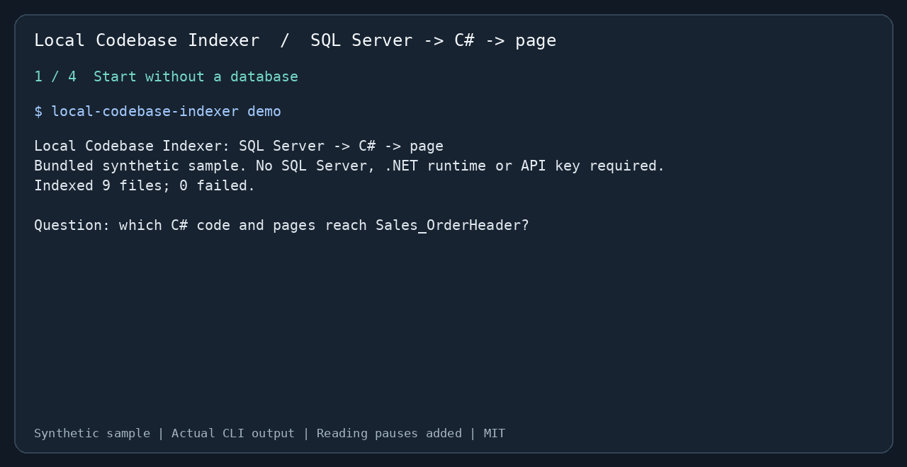

# Local Codebase Indexer

[English](README.md) | **繁體中文** | [简体中文](README.zh-CN.md)

**這張 SQL Server 資料表，會被哪些 C# 程式與頁面使用？**

從原始碼追出資料表、預存程序、Repository、Controller Action 與 Razor 頁面的關係。可以直接用 CLI，也可以透過 MCP 讓 AI 助手取得同樣的路徑與證據。適合維護使用 Dapper、ADO.NET 或 Entity Framework 的 C#／SQL Server 專案。



[可重現案例與完整輸出](docs/case-study.md) · [進階手冊](docs/reference.zh-TW.md) · [PyPI](https://pypi.org/project/local-codebase-indexer/) · [MIT 授權](LICENSE)

## 與 Claude 的 Grep 及類似工具比較

**在本專案的 MES 測試集，相關檔案召回率比 `rg + BM25` 高 9.5～10.7 個百分點。** 內建 SQL → C# → 頁面調查情境中，關係報告涵蓋 **5/5 個必要證據檔案**，單次表名字面搜尋為 **3/5**，涵蓋率 **60% → 100%（+40 個百分點）**。

| 固定搜尋測試集 | `rg + BM25` 檔案 Recall@5 | 本專案 | 差異 |
|---|---:|---:|---:|
| MES 風格合成資料：42 題、24 個檔案 | 81.0% | **91.7%** | **+10.7 個百分點** |
| 相同 42 題加入干擾來源：109 個檔案 | 81.0% | **90.5%** | **+9.5 個百分點** |
| Python 標準函式庫：12 題、85 個真實原始碼檔案 | **100.0%** | 79.2% | −20.8 個百分點 |

召回率是每題找回的已知相關檔案比例，再取平均。基準實際執行 ripgrep，以通用查詢拆詞及 BM25 排序，並非 Claude agent。本專案使用預設 hashing、取 5 個結果區塊；基準取 5 個檔案，雙方都以檔案計分。共 54 個由本專案編寫的不同題目（含重跑干擾集共 96 次），不代表通用準確率保證。

**減少需要閱讀的原始碼：** 在含干擾的 MES 與標準函式庫測試集，搜尋結果文字比「完整讀取同一批選中檔案」少 **94.9%／96.9% 字元**；極小的合成檔案反而多 **2.3%**。這是相對於整檔讀取的輸出大小，並非相對 Grep 摘錄或 Claude token 的節省量。

**較完整報告的成本：** demo CLI 暖查詢 **244.5 ms**，單次字面 `rg` 為 **8.3 ms**（各量測 3 次取中位數；本專案首次查詢含建索引為 **266.1 ms**）。提升在於多追到 Controller／頁面；速度較慢。Controller 路徑標為 `probable`，不代表執行期證明。尚未量測完整 Claude、Serena 或 Claude Context 流程。[方法與重跑命令](docs/tool-comparison.md) · [機器環境與彙總數據](benchmarks/tool-comparison.json) · [全部 96 筆逐題紀錄](benchmarks/tool-comparison-queries.jsonl)。

**這個專案多提供的是 SQL → C# → 頁面的索引關係報告。** 在支援的程式模式中，一次 `data-access` 查詢就能列出直接／透過預存程序的存取、Controller Action、頁面與信心標籤。Claude 也能透過多輪 Grep 與讀檔追出關係；此工具把這段調查整理成可重複執行的 CLI／MCP 結果。

| 工具／流程 | 適合用途 | 取捨與本專案的用途 |
|---|---|---|
| Claude＋Grep／ripgrep | 精確識別字、字串與正規表示式，不需建索引 | 直接核對文字仍優先使用。此專案另提供字面資料表名稱以外的 SQL／呼叫／頁面關係。 |
| [Serena](https://github.com/oraios/serena)＋LSP／JetBrains | 後端提供的符號、引用與編輯／重構 | 精確 rename、多載解析優先使用編譯器／IDE 語意。本專案聚焦 SQL 維護報告，不需設定語言伺服器。 |
| [Claude Context](https://github.com/zilliztech/claude-context) | 自然語言的 BM25＋dense vector 混合搜尋 | 官方設定含 embedding provider 與 Milvus／Zilliz，也支援本機 provider。本專案預設不需 embedding API 或向量伺服器，但 hashing 仍可能漏掉自然語言改寫。 |
| Local Codebase Indexer | SQL Server 表／預存程序 → C# 存取者 → Action／頁面，以及 schema、Git impact | 帶有信心標籤的近似靜態分析，沒有 Roslyn 多載解析或語意 rename。 |

範例的 Controller 與 Razor 頁面沒有該表名字串；關係報告透過預存程序與 C# 呼叫追到它們，**4 項內建關係檢查通過**。[原始碼證據與上游功能資料](docs/tool-comparison.md)。

## 三步開始

需要 **Python 3.10+**，建議在虛擬環境執行。內建 demo 不需要 SQL Server、.NET 執行環境、模型下載或 API key。

**1. 安裝**

```bash
python -m pip install --upgrade local-codebase-indexer
```

若 Python 提示 externally managed environment，先建立並啟用 [venv](https://docs.python.org/3/library/venv.html)。其他獨立安裝方式請看[手冊](docs/reference.zh-TW.md)。

**2. 執行內建範例**

```bash
local-codebase-indexer demo
```

這會在暫存目錄建立**合成範例**、建立索引，並檢查四項預期關係，不會索引目前的工作目錄。動畫使用此命令的實際輸出，另加閱讀停留時間。節錄：

```text
table Sales_OrderHeader
  WRITTEN BY (2)
    [confirmed] procedure dbo.usp_ApproveOrder
    [confirmed] method Shop.Data.OrderRepository.Approve ... via usp_ApproveOrder
  READ BY (1)
    [confirmed] method Shop.Data.OrderRepository.Get
  USED BY PROGRAMS (1)
    [probable] Orders ... (Approve, Details)
        pages: Views/Orders/Details.cshtml
Verified 4/4 expected relationships: PASS
```

使用 `local-codebase-indexer demo --output demo-orders` 把範例保存在新建或空的資料夾；`demo --json` 可取得完整報告。

**3. 換成自己的專案**

```bash
local-codebase-indexer --root "/path/to/project" data-access YourTable
```

替換路徑與資料表名稱。首次查詢建立索引，之後增量更新。若要分析預存程序的內容，原始碼中必須包含 SQL 定義檔；工具不會連線到資料庫。

## 接上 AI 助手

安裝套件後，在 Claude Code 註冊：

```bash
claude mcp add local-indexer -- local-codebase-indexer --root "/absolute/path/to/project" serve
```

可以問：「哪些程式寫入 `YourTable`？哪些 Controller Action 與頁面會到達它？請列出路徑與信心等級。」必要時重新連線或重啟 MCP 用戶端。

其他 stdio MCP 用戶端使用命令 `local-codebase-indexer`，參數依序為 `--root`、專案絕對路徑、`serve`。Codex／Copilot 可使用 CLI；[AGENTS.md](AGENTS.md) 有助手指引。[進階手冊](docs/reference.zh-TW.md) 包含 Claude Code plugin、七個 MCP 工具、ONNX 模型與設定。

## 其他維護問題

```bash
local-codebase-indexer --root "/path/to/project" relations OrderRepository.Approve --direction upstream
local-codebase-indexer --root "/path/to/project" impact main...HEAD
local-codebase-indexer --root "/path/to/project" search "order approval" --explain --limit 5
local-codebase-indexer --root "/path/to/project" doctor
```

可查呼叫者、Git 版本間影響，以及結合識別字、文字與本機 embedding 的搜尋。C#、Python、JavaScript、TypeScript 支援符號解析；T-SQL 與 C# 另有資料存取分析。加上 `--json` 可取得結構化結果。

## 使用前要知道

- 這是帶有信心標籤的**靜態分析**。介面派送可能是 `probable`；名稱比對與動態 SQL 必須回查原始碼。沒有 Roslyn 的多載解析，也不能證明執行時行為。
- 預設 hashing embedder 適合識別字及相關詞，自然語言改寫可能漏查。[基準測試](benchmarks/README.md)與[案例](docs/case-study.md)說明測量方式；demo 四項通過不代表一般準確率或省時成效。
- 索引儲存在 `<project>/.ai_context/indexer.db`，安裝依賴後不需要遠端索引服務。MCP 回傳的程式片段會送到哪裡，取決於你使用的 AI 用戶端與模型供應商。
- 先選一張已知用途的資料表核對結果。漏掉檔案時執行 `doctor --path path/to/file.cs`，檢查 `.gitignore` 與 `.ai_context/ignore`。更多[限制](docs/reference.zh-TW.md)與[待辦](TODO.md)可查手冊。

發現錯誤關係或漏查，請附最小範例[回報 issue](https://github.com/sfy257000/local-codebase-indexer/issues/new/choose)。歡迎[貢獻](CONTRIBUTING.md)。採用 [MIT 授權](LICENSE)。

[SQL／Unicode／VB6 支援與升級說明](docs/sql-legacy-support.md)
