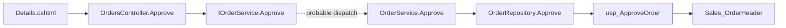

# From a SQL Server table to a C# action and Razor page

This is a **synthetic, bundled maintenance case**, not a customer result. The complete source is in [`demo_project`](../local_codebase_indexer/demo_project); it is a static-analysis fixture, not a runnable .NET application. You do not need a database or .NET runtime.

The question: “If I change how `Sales_OrderHeader.Status` is approved, which code and page should I inspect?” The tool traces table access; it does not perform column-level impact analysis.

## Reproduce

```bash
python -m pip install --upgrade local-codebase-indexer
local-codebase-indexer demo --json
local-codebase-indexer demo --output demo-orders
local-codebase-indexer --root demo-orders data-access Sales_OrderHeader --full
local-codebase-indexer --root demo-orders relations OrderRepository.Approve --direction upstream
```

`demo-orders` must be new or empty. Omit `--output` to use an automatically cleaned temporary directory. `demo --json` exits nonzero if indexing fails or an expected relationship is missing. It always uses the built-in hashing embedder, independent of an optional ONNX configuration.

## Source evidence

| Step | Evidence to inspect | What is inferred |
|---|---|---|
| Table definition | [`Sales_OrderHeader.sql`](../local_codebase_indexer/demo_project/Sql/Sales_OrderHeader.sql) | Defines `Id` and `Status` |
| SQL writer | [`usp_ApproveOrder.sql`](../local_codebase_indexer/demo_project/Sql/usp_ApproveOrder.sql) | `UPDATE dbo.Sales_OrderHeader` |
| C# writer / reader | [`OrderRepository.cs`](../local_codebase_indexer/demo_project/Data/OrderRepository.cs) | Stored-procedure execution and a literal `SELECT` |
| Service dispatch | [`OrderService.cs`](../local_codebase_indexer/demo_project/Services/OrderService.cs), [`IOrderService.cs`](../local_codebase_indexer/demo_project/Services/IOrderService.cs) | Repository callers and interface implementation |
| Controller | [`OrdersController.cs`](../local_codebase_indexer/demo_project/Controllers/OrdersController.cs) | `Approve` and `Details` actions, reached through the service interface |
| Page | [`Details.cshtml`](../local_codebase_indexer/demo_project/Views/Orders/Details.cshtml) | `Url.Action` links to those actions |



The stored-procedure and repository access entries are `confirmed`; the rolled-up controller result is `probable` because the path includes interface dispatch. Inspect the source rather than interpreting these labels as runtime proof.

## Recorded result

[`assets/demo-report.json`](../assets/demo-report.json) contains the complete report, environment, exact-reference baseline, confidence labels, and measured timings. [`demo-output.txt`](../assets/demo-output.txt) contains the full text output. These are one recorded run of version 0.8.0; rerunning produces different timings.

| Observation | Recorded value |
|---|---|
| Files indexed | 9, with 0 failed (8 C#/SQL/Razor source files and a README) |
| Symbols / chunks | 29 / 23 |
| Exact table-name reference files | 3 |
| SQL / C# access | 2 writers, including the indirect stored-procedure writer; 1 reader |
| Program / page roll-up | `Orders` actions `Approve`, `Details`; `Views/Orders/Details.cshtml` |
| Scenario checks | 4 / 4 pass |

An exact table-name search finds the SQL definition, procedure, and repository. The controller and page do not contain the table name. The additional result here is the relation path connecting them. This baseline counts literal references; it does **not** estimate how fast a developer could follow those references manually, or show that text search cannot help.

## Limits and a useful next check

This fixture is deliberately small and covers a known supported pattern. It establishes that the install/demo/navigation path works, not that arbitrary C# applications have complete coverage. Dynamic SQL, overloads, delegates, and reflection can leave gaps. The tool does not validate application behavior or prove a migration is safe.

Search quality is a separate measurement. The 0.7.0 development evaluation on 15 curated questions about this repository recorded Recall@5 of 0.533 and MRR of 0.328; these author-curated questions are not a representative user study. See [`benchmarks/queries_project.json`](../benchmarks/queries_project.json) and [evaluation instructions](reference.md). Do not infer broad natural-language accuracy from the four demo checks.

On your project, first pick a table whose writers and page you already know, verify the returned paths, and save a small question set with checked source locations. Run `evaluate` before relying on search results in a broader workflow. No measured human time savings, token reduction percentage, or production accuracy is claimed here.

## Rebuild the animation and evidence

From a checkout on Linux with DejaVu Sans Mono installed:

```bash
python -m pip install -e ".[media]"
python scripts/render_demo.py
```

Use `--font /path/to/mono.ttf` elsewhere. The script runs the real demo and refuses to render a success result if its checks fail. The 32-second GIF adds reading pauses; it is not a recording of command latency. The JSON includes actual timings from the same run.
